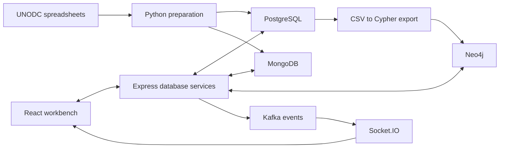

# Global Drug Seizures — Multi-Model Data Warehouse

**Group coursework by Kristian Eieland, Daniela Viktoria Eberhard and Lucas Lange.**

Built for **IKT453 Intelligent Data Management, University of Agder (2025)**. Our group, **SELECT * FROM talent**, explored how relational, document and graph databases represent and query the same global drug-seizure data. This public portfolio edition presents the group project with updated local setup instructions.

## What we built

A Python preparation pipeline, three database implementations, and a React/Node.js workbench for querying and inspecting them:

- **PostgreSQL:** a star schema with a seizure fact table and date, drug, location, transport and source dimensions.
- **MongoDB:** document storage, aggregation queries and inferred collection schemas.
- **Neo4j:** nodes and relationships queried with Cypher and displayed as a graph.
- **React and Express:** database selection, query editing, schema inspection and tabular or graph results in one interface.
- **Kafka and Socket.IO:** application-generated database events are published to Kafka and forwarded to connected browser clients.

The source dataset is the UNODC Individual Drug Seizure dataset. The submitted project report documents **2,526,077 fact records** in the group's PostgreSQL implementation. That is the size of the original coursework dataset, not a bundled dataset or a performance benchmark for this public copy.

## What this project taught me

Working on this group project gave me practical experience with data preparation, relational modelling, SQL joins and aggregation, MongoDB document queries, and graph relationships in Neo4j. Connecting the three databases to one interface made their differences concrete: each needs its own query language, result handling and way of describing the data. Kafka and Socket.IO added experience with events flowing from the backend into the browser.

An important analytical lesson was to preserve measurement units when aggregating seizures. Recorded seizures describe enforcement observations; they do not directly measure national drug consumption.

## Architecture



The editable relational diagram is in [`report/StarSchema.drawio`](report/StarSchema.drawio). The project-specific schema and sample queries are also visible in the source.

## Run the workbench locally

This is a local educational query workbench. Its API accepts database queries and has no user-authentication layer. The supplied development setup binds its published ports to `127.0.0.1`.

1. Clone this repository and install Docker with Docker Compose.

   ```sh
   git clone https://github.com/KrisEie/global-seizures-data-platform.git
   cd global-seizures-data-platform
   ```
2. Copy `.env.example` to `.env` **in the repository root**. Replace all `REPLACE_WITH_...` values with your own local passwords. Keep `NEO4J_USER=neo4j` for the supplied Compose configuration.
3. From `multi-db-query-tool`, run:

   ```sh
   docker compose --env-file ../.env up --build
   ```

4. Open **http://localhost:3000**. The backend health endpoint is **http://localhost:5000/health** and Neo4j Browser is **http://localhost:7474**.

The public checkout starts with **empty databases**. Source spreadsheets, SQL exports, MongoDB backups and Neo4j dumps are not included. Existing project example queries require the original schema and an imported dataset. To check an empty connection first, use `SELECT 1 AS connected;` in PostgreSQL or `RETURN 1 AS connected;` in Neo4j.

Stop the stack with `docker compose --env-file ../.env down`. Named volumes retain your local databases.

### Run the app outside Docker

Use Node.js 22. Start the databases with the same Compose file, then run the app on the host:

```sh
cd multi-db-query-tool
docker compose --env-file ../.env up -d postgres-db mongodb neo4j-db kafka
npm install
npm start
```

`npm start` launches the Express backend and React development server. The backend reads the repository-root `.env`. The example values select the host ports exposed by Compose. `npm run build` builds the React frontend; it does not start or deploy the backend.

## Data preparation

Obtain the dataset directly from the [UNODC Drugs Monitoring Platform](https://dmp.unodc.org/downloadIDS) and follow the source's access and reuse terms. Place source `.xlsx` files in `data/og_data/` on your own machine.

The original preparation scripts are retained as coursework tools, not a fully automated importer for arbitrary new UNODC releases. They rely on the original column names and exported table layouts. Review the input format before importing into a database you want to keep.

```sh
python -m pip install -r requirements.txt
cd data/code
python execute_pipeline.py
```

This splits workbook sheets, corrects known column-name inconsistencies, and writes processed CSV files. From `data/code/create_PG_DB`, `python create_PG_DB.py` creates/imports the relational model. It reads the root `.env`, uses `data/processed_data/`, and prompts before replacing an existing database. Its export step also requires PostgreSQL's `pg_dump` on your PATH.

`data/code/import_to_mongodb.py` imports the split CSV files into MongoDB. `data/code/creata_cql_files.py` generates Cypher from exported relational table CSVs; it is **not** a direct importer of the source workbooks. The provided `import_cql_files.py` uses `cypher-shell`, the root `.env`, and the generated files in `data/neo4j_db/`.

## Repository map

| Path | Contents |
|---|---|
| `data/code/` | Original preparation, relational import, MongoDB import and Cypher conversion scripts |
| `data/neo4j_db/` | Graph index and relationship definitions |
| `multi-db-query-tool/src/` | React query interface and result visualizations |
| `multi-db-query-tool/server/` | Express routes, database adapters and Kafka integration |
| `report/StarSchema.drawio` | Editable relational schema diagram |
| `PROVENANCE.md` | Original team attribution, source revision and public-edition changes |

## Public-edition scope

This edition removes local credentials, machine-specific setup notes, installers, database dumps, source spreadsheets and the unused earlier prototype. Connection details come from environment variables. The raw original Git history is not republished because it contains legacy configuration and data artifacts. [PROVENANCE.md](PROVENANCE.md) records the source revision and team attribution.

The React production build and source checks are useful packaging checks; they do not establish that the complete original multi-million-row import has been reproduced. See the verification notes in `PROVENANCE.md`.

## Credits and licensing

**Original project authors:** Kristian Eieland, Daniela Viktoria Eberhard and Lucas Lange.  
**Course:** IKT453 Intelligent Data Management, University of Agder, 2025.  
**Group:** SELECT * FROM talent.  
**Supervisor:** Associate Professor Vladimir Iosifovich Zadorozny.

No project-wide open-source license was supplied with the original repository, so this edition does not assign a new license to the group's work. Third-party dependencies and the external dataset retain their respective terms.
